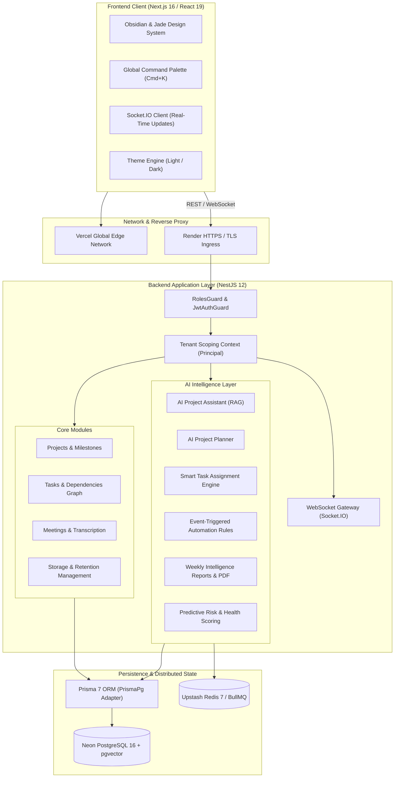
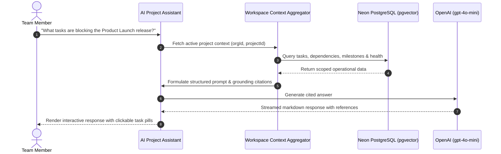

# NEXORA — Architecture & System Design

NEXORA is an AI-powered multi-tenant work operating system built as a modern TypeScript monorepo combining Next.js, NestJS, Prisma 7, PostgreSQL with pgvector, Redis BullMQ queues, and LLM integrations.

---

## 1. System Topology

---

## 2. Multi-Tenant Isolation & Security Model

NEXORA operates on a strict multi-tenant boundary:
1. **Principal Extraction:** Authentication requests validate JWT signatures and extract `{ sub, orgId, role, email, name }`.
2. **Database Query Scoping:** Every Prisma query includes an explicit `where: { organizationId: user.orgId }` clause. Cross-tenant access is architecturally prevented at the database layer.
3. **Role-Based Access Control (RBAC):**
   - `OWNER`: Full organization control, billing, integrations, and member deletion.
   - `ADMIN`: Project and workspace settings management.
   - `PROJECT_MANAGER`: Workflow automations, health recalculation, task lifecycle approval.
   - `TEAM_MEMBER`: Task creation, comment authoring, status progression.
   - `VIEWER`: Read-only access across all workspace views.

---

## 3. Background Job & Queue Architecture

NEXORA leverages **BullMQ** on **Redis** for asynchronous processing:
- **Project Health Recalculation:** Triggered on bulk status shifts, task cancellations, and scheduled cron ticks.
- **Storage Retention Sweeps:** Automatic lifecycle enforcement based on organization retention policies and legal hold tags.
- **Fail-Safe In-Process Fallback:** When Redis is unreachable or on resource-constrained free tiers, the application automatically activates bounded synchronous fallbacks to ensure uninterrupted operation.

---

## 4. AI Engine & Grounded Context Model

