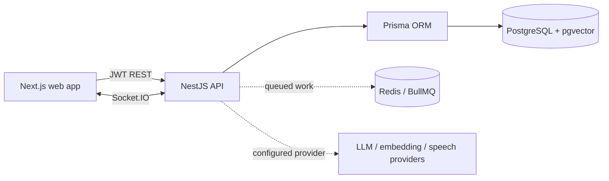

# Nexora architecture

## Product shape

Nexora is a multi-tenant work operating system. The MVP includes a responsive workspace dashboard backed by a REST API and PostgreSQL: account registration/login, organization membership roles, project/task CRUD, task dependencies, risk analysis, AI plans with human approval, meeting recordings with grounded transcript decisions/actions, calendar/timeline views, and append-only audit events. Socket.IO broadcasts authorized project updates. Provider-dependent capabilities use explicit adapters and remain unconfigured until credentials are supplied.

## Runtime layout

The browser is a presentation client only. Tenant scoping, role checks, request validation and AI action approvals live on the API. Every tenant-owned query receives an organization id derived from an authenticated membership, never from an untrusted body field. Project access is checked in addition to organization membership for project resources. Audit events are insert-only through application services.

## Data design

`User` has organization memberships; an `Organization` is the tenant boundary. Projects, tasks, dependencies, comments, meetings, documents, notifications, AI proposals, integrations and search chunks reference the organization. Tasks belong to projects and may depend on other tasks in the same organization. The dependency service rejects cycles. AI plans are stored as reviewable proposals and only materialized after explicit approval. Search chunks keep an optional pgvector embedding and a source reference; retrieval must scope by organization and authorization before ranking.

See `apps/api/prisma/schema.prisma` for the canonical relational model. The schema is defined before application modules so future modules can be added without changing tenant ownership conventions.

## API modules and boundaries

- `auth`: registration, login, JWT access token, password hashing.
- `organizations`: tenant creation, current workspace and membership role checks.
- `projects`: tenant-scoped project lifecycle and membership.
- `tasks`: task lifecycle, dependency constraints, downstream impact, comments, and notification events.
- `meetings`: tenant-scoped meeting CRUD, private local recording storage, queued transcription/analysis, exact transcript evidence validation, action approval/rejection/expiry, and task conversion after approval.
- `calendar`: bounded tenant-scoped event queries for projects, tasks, milestones and meetings, with critical-path and downstream metadata.
- `search`: tenant-scoped keyword retrieval across projects, tasks, comments, meetings and documents; optional pgvector ranking with a configured embedding provider.
- `notifications`: per-user unread state, assignment/comment/mention/blocker signals, per-user realtime inbox refresh, and BullMQ deadline sweeps (09:00 UTC daily, retries with exponential backoff, deduplicated reminder keys, and queue status for managers).
- `ai`: provider adapter, validated plan proposal/approval, cited workspace Q&A, deterministic portfolio risk analysis, and blocker analysis. Proposals expire after seven days; approve/reject and task creation are conditional transactions with audit events.
- `audit`: append-only record creation and tenant-scoped listing.
- `common`: auth/role guards, validation, request context and errors.

Meeting recordings are stored in private local files by default; configure `MEETING_STORAGE_DIR` and restrict access to the API process. Hosted object storage and retention controls remain future work. Transcription and analysis require provider credentials. GitHub uses one-time tenant-bound OAuth state, AES-256-GCM encrypted tokens, repository-to-project links, signed webhooks and explicit task references; configure the GitHub OAuth app and encryption key before connecting. Google Calendar/Gmail OAuth sync remains unimplemented. Credentials are never required to start core local development.

## Security and reliability decisions

- Passwords use bcrypt with a 72-byte input limit; JWT secrets come from environment configuration and the active workspace membership is checked on API requests.
- All write DTOs use class-validator and unknown properties are rejected.
- Tenant and project IDs are resolved and authorized before mutation.
- Dependency edits run in a transaction and reject self-links and cycles.
- AI generation is a proposal only. Applying a proposal is an authenticated, role-checked, expiry-checked transaction; stored output is revalidated, repeat execution is blocked by conditional status transitions, and create/approve/reject events are audited.
- Audit rows have no update/delete service or API route.
- External text is passed to AI as untrusted context; the model cannot execute database tools directly.
- OAuth/webhook integrations require state/signature validation before enabling sync.

## Implementation plan and status

| Phase | Scope | Status |
|---|---|---|
| 1 | Architecture, repository setup, schema, core auth | Complete; email verification and recovery pending |
| 2 | Workspaces, memberships, RBAC | Core complete; ownership transfer and granular project roles pending |
| 3 | Projects, tasks, dependencies, dashboard | Core complete; calendar/timeline views added, attachments and advanced filtering pending |
| 4 | Realtime collaboration and notifications | Partial: comments, authorized rooms, presence events, in-app notices and daily BullMQ deadline reminders; presence UI and advanced schedules pending |
| 5 | AI planning, blocker analysis, duplicate detection | Core flows complete; cited workspace Q&A and portfolio risk signals added; duplicate detection remains lexical |
| 6 | Meeting processing and semantic search | Meeting CRUD, private local audio upload, queued transcription/analysis, transcript-grounded decisions/actions, and GitHub event search sources; hosted storage and broader document/activity indexing pending |
| 7 | Approval workflows and audit logs | AI plan and meeting action review, expiry, repeat-execution protection and immutable audit events implemented; additional action types pending |
| 8 | GitHub, Calendar, Gmail | GitHub OAuth, encrypted token storage, repository linking and signed webhook activity capture implemented; automatic task status rules and Google Calendar/Gmail sync pending |
| 9 | Automated tests, hardening, deployment | Unit, disposable-database HTTP security/workflow, Chromium browser journey and backup/restore rehearsal run locally; production hardening/deployment automation pending |

## Risks and open constraints

1. OAuth, speech transcription and hosted LLM behavior cannot be verified until provider credentials are configured. Credential-backed provider paths are not exercised by the local test suite.
2. Local end-to-end behavior requires Docker services or equivalent PostgreSQL/Redis services.
3. Calendar/timeline views support explicit date editing; drag-to-reschedule is not implemented. GitHub webhook activity is captured, but merge-to-task status rules are not automatic. Google integrations, hosted storage, and hardened operations remain staged work.
4. Refresh-token rotation, email verification delivery and password reset delivery need an email provider before production activation.
5. The production dependency audit is clean. The full audit still reports eight moderate entries counted across a development-only `minimatch` advisory chain in the Next.js ESLint tree; see [SECURITY_AUDIT.md](SECURITY_AUDIT.md).

## Framework and database configuration

NestJS 12 packages are pinned consistently. Prisma 7 uses `@prisma/adapter-pg`; the connection URL and migration settings live in `apps/api/prisma.config.ts`. The additive AI proposal expiration migration backfills existing proposals and does not reset or replace database records.
