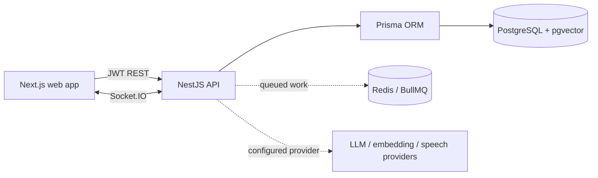

# Nexora architecture

## Product shape

Nexora is a multi-tenant work operating system. The MVP includes a responsive workspace dashboard backed by a REST API and PostgreSQL: account registration/login, organization membership roles, project/task CRUD, task dependencies, risk analysis, AI plans with human approval, meeting recordings with grounded transcript decisions/actions, calendar/timeline views, and append-only audit events. Socket.IO broadcasts authorized project updates. Provider-dependent capabilities use explicit adapters and remain unconfigured until credentials are supplied.

## Runtime layout

The browser is a presentation client only. Tenant scoping, role checks, request validation and AI action approvals live on the API. Every tenant-owned query receives an organization id derived from an authenticated membership, never from an untrusted body field. Project access is checked in addition to organization membership for project resources. Audit events are insert-only through application services.

## Data design

`User` has organization memberships; an `Organization` is the tenant boundary. Projects, tasks, dependencies, comments, meetings, documents, notifications, AI proposals, integrations and search chunks reference the organization. Tasks belong to projects and may depend on other tasks in the same organization. The dependency service rejects cycles. AI plans are stored as reviewable proposals and only materialized after explicit approval. Search chunks keep an optional pgvector embedding and a source reference; retrieval must scope by organization and authorization before ranking.

See `apps/api/prisma/schema.prisma` for the canonical relational model. The schema is defined before application modules so future modules can be added without changing tenant ownership conventions.

## API modules and boundaries

- `auth`: registration, login, JWT access token, password hashing.
- `organizations`: tenant creation, current workspace and membership role checks.
- `projects`: tenant-scoped project lifecycle and membership.
- `tasks`: task lifecycle, dependency constraints, downstream impact, comments, and notification events.
- `meetings`: tenant-scoped meeting CRUD, private audio storage with modular provider architecture, queued transcription/analysis, exact transcript evidence validation, action approval/rejection/expiry, and task conversion after approval.
- `storage`: modular private cloud storage provider architecture (`StorageProvider` interface with `LocalStorageProvider` and zero-dependency SigV4 `S3StorageProvider`), tenant isolation, MIME magic validation, SHA-256 checksums, presigned URLs, organization retention policies, legal holds (`FileRetentionHold`), dry-run preview, and BullMQ background cleanup sweeps.
- `project-health`: deterministic multi-dimension project health scoring engine, rule-based predictive risk engine (10 risk patterns), velocity-based explainable delay forecasting, actionable remediation recommendations, background calculation queue (`nexora-project-health`), snapshot history, and human-in-the-loop proposal generation.
- `calendar`: bounded tenant-scoped event queries for projects, tasks, milestones and meetings, with critical-path and downstream metadata.
- `search`: tenant-scoped keyword retrieval across projects, tasks, comments, meetings and documents; optional pgvector ranking with a configured embedding provider.
- `notifications`: per-user unread state, assignment/comment/mention/blocker signals, per-user realtime inbox refresh, and BullMQ deadline sweeps (09:00 UTC daily, retries with exponential backoff, deduplicated reminder keys, and queue status for managers).
- `ai`: provider adapter, validated plan proposal/approval, cited workspace Q&A, deterministic portfolio risk analysis, and blocker analysis. Proposals expire after seven days; approve/reject and task creation are conditional transactions with audit events.
- `audit`: append-only record creation and tenant-scoped listing.
- `common`: auth/role guards, validation, request context and errors.

Meeting recordings are stored in private local files by default; configure `MEETING_STORAGE_DIR` and restrict access to the API process. Hosted object storage and retention controls are supported via modular LocalStorageProvider and S3CompatibleStorageProvider with retention policies and legal holds. Transcription and analysis require provider credentials. GitHub uses one-time tenant-bound OAuth state, AES-256-GCM encrypted tokens, repository-to-project links, signed webhooks and explicit task references. Google Workspace uses one-time tenant-bound OAuth state, AES-256-GCM encrypted access and refresh tokens, Google Calendar incremental sync with sync-token recovery, and Gmail context extraction with human-in-the-loop task proposals. Credentials are never required to start core local development.

## Security and reliability decisions

- Passwords use bcrypt with a 72-byte input limit; JWT secrets come from environment configuration and the active workspace membership is checked on API requests.
- All write DTOs use class-validator and unknown properties are rejected.
- Tenant and project IDs are resolved and authorized before mutation.
- Dependency edits run in a transaction and reject self-links and cycles.
- AI generation is a proposal only. Applying a proposal is an authenticated, role-checked, expiry-checked transaction; stored output is revalidated, repeat execution is blocked by conditional status transitions, and create/approve/reject events are audited.
- Audit rows have no update/delete service or API route.
- External text is passed to AI as untrusted context; the model cannot execute database tools directly.
- OAuth/webhook integrations require state/signature validation before enabling sync.

## Release 4.1: Project Health Scoring & Predictive Risk Engine

### 1. Deterministic Multi-Dimension Health Scoring
The health score is computed deterministically across five weighted dimensions, with scores strictly bounded between 0 and 100:
- **Task Completion & Progress (25%)**: Ratio of completed countable tasks, weighted by priority (URGENT: 4x, HIGH: 3x, MEDIUM: 2x, LOW: 1x), combined with expected schedule progress based on project start and due dates.
- **Deadline Performance (25%)**: Measures overdue active tasks, penalizing critical-path overdue items heavily. Overdue tasks subtract points with escalating penalties for tasks overdue by >3 and >7 days.
- **Blockers & Dependencies (25%)**: Penalizes blocked tasks, dependency bottleneck hubs (tasks blocking >=3 downstream tasks), and critical-path blocked tasks.
- **Milestone Performance (15%)**: Evaluates milestone completion ratio and applies severe penalties (-35 points per overdue milestone) and warnings for near-term milestones (<14 days) threatened by blocked or overdue tasks. Defaults to 85 neutral baseline when no milestones are defined.
- **Recent Activity & Momentum (10%)**: Measures workspace activity momentum across task updates, completions, comments, GitHub commits/PRs, and meeting action items. High recent activity scores 100; inactivity over 14/28 days scales down to 20-40.

**Health Classifications**:
- `HEALTHY` (80–100): Strong performance across all dimensions with low risk.
- `AT_RISK` (50–79): Trailing schedule, multiple overdue tasks, or unresolved bottlenecks.
- `CRITICAL` (0–49): Severe blockers, missed milestones, or critical-path gridlocks.
- `INSUFFICIENT_DATA` (score: `null`): Assigned when a project has zero tasks or only cancelled tasks. Explicitly avoids false `HEALTHY` labels when data is missing.
- `EXCLUDED` (score: `null`): Applied to completed and archived projects, excluding them from active workspace monitoring.

### 2. Rule-Based Predictive Risk Engine
Evaluates ten deterministic risk rules using structural project signals. Each risk generates an idempotent SHA-256 fingerprint:
1. `OVERDUE_TASKS`: Active tasks past due date, escalating to CRITICAL if on critical path.
2. `INSUFFICIENT_PROGRESS`: Tasks due within 7 days still in TODO with >=70% elapsed duration.
3. `BLOCKED_HIGH_PRIORITY`: Urgent or high-priority tasks blocked by incomplete dependencies.
4. `DEPENDENCY_BOTTLENECK`: Tasks blocking 2 downstream tasks or gating critical path progress.
5. `MULTI_DOWNSTREAM_BLOCK`: Tasks blocking 3 or more downstream tasks.
6. `MILESTONE_AT_RISK`: Overdue milestones or upcoming milestones (<14 days) threatened by blockers.
7. `DECLINING_MOMENTUM`: Active projects with historical completions but zero completions in the past 14 days.
8. `UNASSIGNED_HIGH_PRIORITY`: Urgent or high-priority tasks near due date with no assignee.
9. `STALE_PROJECT`: Projects with active tasks but zero recorded updates in 14+ days.
10. `HIGH_WORKLOAD_UPCOMING`: Project deadline within 7 days with >=40% and >=3 incomplete tasks.

**Risk Dismissal & Reappearance Lifecycle**:
Managers can dismiss risks with an audit-logged reason. A dismissed risk remains dismissed on recalculation as long as its condition has not worsened (matching fingerprint and severity). If the condition worsens (e.g., additional overdue tasks or heightened severity), the risk automatically reactivates into the active risk queue.

### 3. Velocity-Based Explainable Delay Forecasting
Calculates project completion velocity over a 30-day window:
- Forecast classifications: `ON_TRACK`, `AT_RISK_OF_DELAY`, `LIKELY_DELAYED`, `INSUFFICIENT_DATA`.
- Transparent confidence indicators (`HIGH`, `MEDIUM`, `LOW`): Projects with fewer than 2 completed tasks apply a transparent heuristic fallback labeled `confidence: 'LOW'`, never misrepresenting heuristic projections as trained machine learning models.

### 4. Background BullMQ Queue & Offline Resilience
- Queue `nexora-project-health` runs with concurrency 2 and exponential backoff retry.
- Recalculation jobs use deduplicated IDs (`health-calc-${projectId}`).
- When Redis is unconfigured or unreachable, the service falls back to synchronous bounded calculation, ensuring zero disruption to workspace operations.

## Implementation plan and status

| Phase | Scope | Status |
|---|---|---|
| 1 | Architecture, repository setup, schema, core auth | Complete; email verification and recovery pending |
| 2 | Workspaces, memberships, RBAC | Core complete; ownership transfer and granular project roles pending |
| 3 | Projects, tasks, dependencies, dashboard | Core complete; calendar/timeline views added, attachments and advanced filtering pending |
| 4 | Realtime collaboration and notifications | Partial: comments, authorized rooms, presence events, in-app notices and daily BullMQ deadline reminders; presence UI and advanced schedules pending |
| 5 | AI planning, blocker analysis, duplicate detection | Core flows complete; cited workspace Q&A and portfolio risk signals added; duplicate detection remains lexical |
| 6 | Meeting processing and semantic search | Meeting CRUD, private audio upload (local & S3), queued transcription/analysis, transcript-grounded decisions/actions, and GitHub event search sources; broader activity indexing pending |
| 7 | Approval workflows and audit logs | AI plan and meeting action review, expiry, repeat-execution protection, storage retention policies/holds, and immutable audit events implemented |
| 8 | GitHub, Storage, Calendar, Gmail | GitHub OAuth, repository linking, automation rules, private cloud storage (local/S3 with retention policies & legal holds), and Google Workspace (Calendar sync & Gmail intelligence) implemented |
| 9 | Release 4.1: Project Health & Predictive Risk Engine | Deterministic 5-dimension scoring, 10 predictive risk rules, explainable delay forecasting, recommendations, background BullMQ queue, and frontend health dashboard implemented |
| 10 | Automated tests, hardening, deployment | Unit, disposable-database HTTP security/workflow, Chromium browser journey and backup/restore rehearsal run locally; production hardening/deployment automation pending |

## Risks and open constraints

1. OAuth, speech transcription and hosted LLM behavior cannot be verified until provider credentials are configured. Credential-backed provider paths are not exercised by the local test suite.
2. Local end-to-end behavior requires Docker services or equivalent PostgreSQL/Redis services.
3. Calendar/timeline views support explicit date editing; drag-to-reschedule is not implemented. GitHub webhook activity is captured, but merge-to-task status rules are not automatic. Google integrations, hosted storage, and hardened operations remain staged work.
4. Refresh-token rotation, email verification delivery and password reset delivery need an email provider before production activation.
5. The production dependency audit is clean. The full audit still reports eight moderate entries counted across a development-only `minimatch` advisory chain in the Next.js ESLint tree; see [SECURITY_AUDIT.md](SECURITY_AUDIT.md).

## Framework and database configuration

NestJS 12 packages are pinned consistently. Prisma 7 uses `@prisma/adapter-pg`; the connection URL and migration settings live in `apps/api/prisma.config.ts`. The additive AI proposal expiration migration backfills existing proposals and does not reset or replace database records.
